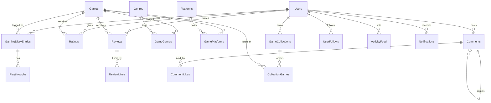

# Database design (PostgreSQL)

## Conventions

- Primary keys: `uuid` (UUIDv7, generated by the application) except lookup tables (`int`).
- Timestamps: `timestamp with time zone`, always UTC.
- Enums are stored as readable strings.
- Usernames and e-mails are unique on a **normalised (lower-case) column**, so uniqueness
  does not depend on a database extension.
- Ratings are integer half-stars `1..10` (see ADR 0002).
- Free-text search on game titles uses a `pg_trgm` GIN index on `lower(Title)`.

## Key constraints

| Table | Constraint |
|-------|------------|
| Users | unique `UsernameNormalized`, unique `EmailNormalized` |
| Games | unique `Slug`, unique `(ExternalProvider, ExternalId)` |
| GamingDiaryEntries | unique `(UserId, GameId)` |
| Playthroughs | `CompletedOn >= StartedOn`, unique `(DiaryEntryId, Number)` |
| Ratings | unique `(UserId, GameId)`, `HalfStars BETWEEN 1 AND 10` |
| Reviews | unique `(UserId, GameId)` |
| Comments | exactly one of `GameId` / `ReviewId` is set |
| CommentLikes / ReviewLikes | composite primary key |
| CollectionGames | unique `(CollectionId, GameId)`, unique `(CollectionId, Position)` |
| UserFollows | primary key `(FollowerId, FolloweeId)`, `FollowerId <> FolloweeId` |

## Denormalised columns

Read-heavy numbers are stored next to the data they summarise and recomputed by one SQL `UPDATE` after each
change (never by read-modify-write in application memory), so concurrent writers cannot lose updates.

| Column | Meaning |
|--------|---------|
| `Games.RatingCount`, `Games.RatingSum` | Average rating = `RatingSum / RatingCount / 2` stars |
| `Games.CompletedCount` | Number of users with the game marked completed (popularity, "most completed") |
| `Reviews.LikeCount`, `Reviews.CommentCount` | Counters shown on review cards |
| `Comments.LikeCount`, `Comments.ReplyCount` | Counters shown in threads |

Deleted comments keep their row (`DeletedAt` set, body cleared) so reply threads stay intact.

## Account security columns

`Users.SecurityStamp` is copied into the session cookie and changes with the password, which invalidates other
sessions. `FailedLoginCount` and `LockoutEnd` implement a temporary lockout after repeated failed sign-ins.

## Indexes worth knowing

| Index | Serves |
|-------|--------|
| `IX_Games_Title_Trgm` (GIN, `lower(Title)`) | Fuzzy title search |
| `IX_Games_ReleaseDate`, `_CompletedCount`, `_RatingCount` | Catalog sorting and discovery rails |
| `IX_GamingDiaryEntries_UserId_Status` | Diary tabs per status |
| `IX_Reviews_GameId_CreatedAt`, `IX_Comments_GameId_LikeCount` | Newest/popular ordering on game pages |
| `IX_ActivityFeed_ActorId_CreatedAt` | Feed queries for the people you follow |
| `IX_Notifications_RecipientId_ReadAt_CreatedAt` | Unread count and the notification list |
